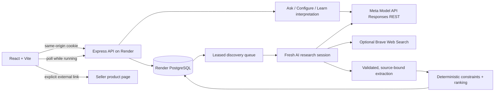

# FairBuy architecture

This describes the implemented application. The original [proposal](docs/PROPOSAL.md) is preserved as historical planning, not a list of shipped features.

## Combining the demos

- **Alberto:** the Ask → Configure → Discovery ↔ Learn → Buy journey, restrained green visual language, editable brief, product reasons/trade-offs, Learn modal, Undo and read-only seller selection. Rebuilt around persistent API state, not the category-specific fixture router.
- **Alessandro:** the Zod-validated shared contract, field-level provenance, unknown values, delivered-cost handling, deterministic hard-constraint filtering and transparent ranking. Adapted to generic attributes and EUR/CHF/USD/GBP.
- **New:** real Meta Model API REST orchestration, optional Brave search, isolated anonymous sessions, PostgreSQL persistence/queue, source validation, cost guards, deployment and CI. The old NestJS/in-memory skeleton and client-side keyword interpreter are not parallel production engines. Express is intentionally the smaller same-origin hosting layer; Meta Model API is the only live interpreter.

## AI session lifecycle

1. **Ask:** a logical `askSessionId` and persistent transcript. Every request sends the transcript and current brief to `ASK_MODEL`. The model asks relevant questions, not a fixed number of wizard steps. The server requires category, purpose, country and model readiness before Configure.
2. **Configure:** its own `configureSessionId`, transcript, system prompt and the `CONFIGURE_MODEL` calls. Manual edits are sent before the next chat request. No product searching occurs here.
3. **Discovery:** each round has a new UUID, `discoverySessionId`, and immutable context snapshot. `initialConfig` is captured on the first search. The snapshot includes the initial request, original configuration, current configuration, every distinct prior product, discarded products and the full active feedback log. There is no `previous_response_id` or hidden provider thread.
4. **Learn:** the smaller model interprets feedback; the original text is always retained. A selected product is discarded by stable normalized-model ID. New preferences stay separate from the editable base brief. Latest explicit learned refinements to the same attribute take precedence in the effective search config; budget refinements use `total` in minor currency units. Undo removes only its feedback entry and starts another fresh search. Later independent feedback and base edits remain. A manual edit to an attribute already overridden by feedback should be accompanied by Undo of that feedback.
5. **Buy:** selection of a currently eligible product, followed by read-only seller offers and source links. No checkout, payments, cart, affiliate redirection, booking or seller messaging endpoint exists.

All Model API calls use `https://api.meta.ai/v1/responses`, server-side `fetch`, `store: false`, `reasoning.effort` bounded by `REASONING_EFFORT` (no `"max"` on the Contributor model), `text.format` schema-constrained JSON with strict subset validation disabled, Zod validation, bounded output and a 75-second per-call deadline. System instructions and untrusted input are separate. The application owns session memory; disabling response storage is **not** a claim of zero provider retention.

## Discovery and evidence

- Default: a required Meta `web_search` tool call produces research and provider-returned citations (`web_search_call.results` plus `url_citation` annotations). A second tool-free call extracts structured products from that research. The model decides whether to run the search; rounds without a completed search fail loudly rather than inventing offers.
- Optional Brave: one bounded query to the official Web Search API, with current requirements and feedback; extraction uses returned snippets. There is no arbitrary server-side page crawling. Brave mode is explicitly **snippet-only** and may return fewer grounded offers. Crawlora can be added behind `AIProvider` after validating its API and access terms; it is not a claimed integration.
- Only public HTTPS non-IP links without credentials or nonstandard ports are accepted. An offer URL must exactly match a source returned in that run; its quoted evidence must be a literal substring of the research. Attributes without literal research evidence are dropped. Data is rendered as text, never HTML.
- These checks establish provenance, **not factual verification**. Model extraction can still misread evidence, and search snippets can be stale. Fields remain seller claims/unknown, not verified. The server never fetches a model/user-selected URL, eliminating an arbitrary-URL SSRF surface.
- Product grouping uses normalized model names, not a manufacturer identity catalog. A model renamed by the AI could evade a past dismissal; this limitation is not hidden. Query coverage, stock, seller legitimacy, compatibility and prices are not guaranteed.

## Deterministic decision layer

Amounts are integer minor units. Unknown costs are excluded from sums and mark totals as lower bounds, never free. Unknown item prices do not earn a low-cost advantage. Different currencies are excluded instead of silently converted. Known hard failures and sold-out offers are excluded before scoring; unknown hard checks remain visibly unverified.

Ranking version `1.0.0`: **30% normalized complete cost + 50% matched soft constraints + 20% evidence reliability**. Incomplete totals earn no cost credit. Unknown preferences do not count as matched. Stable offer IDs resolve ties; near ties are disclosed. The score is a reproducible preference/evidence measure, not a quality, fraud or safety guarantee. No LLM writes a numerical match score.

## Persistence, queue and security

- `shopping_sessions`: owner hash, JSONB state and immutable round snapshots, seven-day expiry.
- `discovery_jobs`: atomically inserted with session updates, claimed with `FOR UPDATE SKIP LOCKED`, five-minute leases, at most two research attempts after interruptions. Ordinary provider failures are not automatically retried; the user can refresh. Two concurrent jobs per process.
- Session mutations use row locks/transactions. Overlapping discovery clicks are idempotent. Async results commit only to their running round. Completed jobs cannot resurrect deleted sessions; foreign-key cascade removes jobs with their search.
- Schema initialization is idempotent and serialized with a PostgreSQL advisory lock. Startup reruns it; `db:migrate` is also a Blueprint pre-deploy step. Add versioned migrations for future incompatible schema changes.
- Random 256-bit anonymous-owner capability in an HttpOnly, SameSite=Lax cookie (Secure in production), with only its SHA-256 hash in PostgreSQL. Resource IDs do not confer ownership. This is not an account system or multi-device authentication.
- Custom request header + origin checks on writes, no cross-origin API access, Helmet/CSP, input/body limits, sanitized errors and no conversation/provider-body logging.
- Render generates a deployment access token by default. Per-owner AI rate limits and a per-IP daily limit help cap abuse; provider billing caps must also be configured. These limiters are process-local: Blueprint intentionally runs one instance. Shared rate-limit storage is required before horizontal scaling.
- Sessions are inaccessible immediately on expiry; hourly cleanup removes expired data. “New search” deletes the active search. Backups and provider retention are separate policies.

## Deployment boundaries

One paid Render Node web service serves both compiled API and Vite assets. A private Render PostgreSQL instance persists all live state. No Supabase account, external Redis, cross-origin frontend, or browser provider keys are required. Memory storage is restricted to explicit local demo/test use. PostgreSQL is mandatory in production and live mode.

This is a working shopping research application, not a promise of production SLAs, universal marketplace coverage, signed-in accounts, offline/PWA behavior or transactional purchasing.
