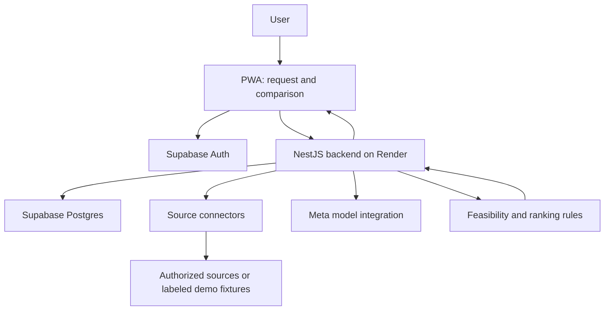

# Architecture

> High-level target architecture, not an implemented system. For product scope and detailed design considerations, see the [proposal](docs/PROPOSAL.md).

## What we expect to build

A personal shopping assistant that turns a user's needs into a clear comparison of feasible options. It should explain the real cost and tradeoffs, show where information comes from, and leave the purchase decision to the user.

## Main building blocks

| Component | Expected responsibility |
|---|---|
| **PWA** | Mobile-friendly interface for describing a need, adding links or screenshots, setting constraints, and comparing results. |
| **NestJS backend on Render** | Coordinate searches and analysis, enforce access permissions, track comparison progress, and return a consistent result. |
| **Supabase Auth** | Sign-in and user identity. The backend validates identity before accessing private comparisons. |
| **Supabase Postgres** | Store preferences, comparisons, offers, source evidence, and processing status, with user-level data isolation. |
| **Source connectors** | Bring information from supported, authorized sources into a common format. Manual inputs and clearly labeled fixtures support the MVP. |
| **AI integration** | Interpret requests, clarify preferences, and extract structured facts from text or supported images. Start with one suitable Meta model route, subject to access and capability verification. |
| **Comparison engine** | Apply hard constraints, calculate known total costs, and rank feasible options with an understandable explanation. Rules, not the language model, determine feasibility and numerical ranking. |

Supabase Storage may be added for uploaded screenshots when needed. Extra workers or infrastructure should be introduced only when the MVP requires them.

## Expected user journey

1. **Describe the need:** the user provides a request, budget, preferences, and any hard constraints.
2. **Collect options:** the backend uses user-submitted material and available connectors.
3. **Understand and normalize:** AI extracts relevant attributes; the system records evidence and missing information. The user can correct errors.
4. **Compare:** deterministic rules exclude infeasible options and explain costs and tradeoffs.
5. **Present the choice:** the PWA shows alternatives, sources, freshness, and uncertainty. The user decides what to do next.

Longer comparisons can run as background jobs with visible progress, rather than requiring a single blocking request.

## One core, different shopping scenarios

The same comparison flow should support category-specific inputs and rules:

- **New products:** specifications, compatibility, delivered price, warranty, returns, and support.
- **Used goods:** condition, missing accessories, pickup travel, and uncertainty.
- **Flights:** door-to-door costs and timing across airlines and departure airports, including the earliest permitted departure from home.
- **Food:** an equivalent basket across delivery services and restaurant-direct, including applicable fees and availability.

For the MVP, implement only the new/used electronics journey in one city. Flights and food remain extensions, not promised live integrations.

## Boundaries we want to preserve

- Keep provider credentials and privileged database access on the backend.
- Keep each user's private data isolated and collect only what is needed.
- Treat source content as data, never as instructions for the agent.
- Distinguish verified facts, seller claims, estimates, and unknowns.
- Label demo fixtures and avoid implying complete market coverage or guaranteed live prices.
- Do not perform checkout, payments, seller messaging, or bookings.

## Deployment shape

**PWA frontend + NestJS service on Render + Supabase for data and authentication + one AI provider route.** Frontend hosting and any separate worker deployment remain implementation decisions. Marketplace access, model availability, and hosting costs must be validated before implementation.

Keep the first version small: a usable end-to-end comparison matters more than connecting every marketplace or sponsor.
