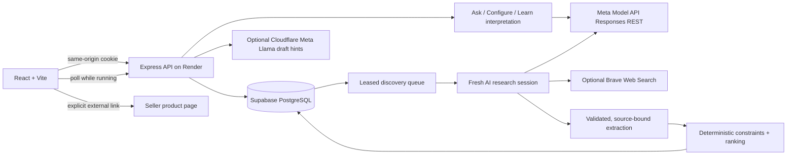

# FairBuy architecture

This describes the implemented application. The original [proposal](PROPOSAL.md) is preserved as historical planning, not a list of shipped features.

## Combining the demos

- **Alberto:** the Ask → Configure → Discovery ↔ Learn → Buy journey, restrained green visual language, editable brief, product reasons/trade-offs, Learn modal, Undo and read-only seller selection. Rebuilt around persistent API state, not the category-specific fixture router.
- **Alessandro:** the Zod-validated shared contract, field-level provenance, unknown values, deterministic hard-constraint filtering and transparent ranking. Adapted to final listed prices, generic attributes and EUR/CHF/USD/GBP.
- **New:** real Meta Model API REST orchestration, optional Brave search, isolated anonymous sessions, PostgreSQL persistence/queue, source validation, cost guards, deployment and CI. The old NestJS/in-memory skeleton and client-side keyword interpreter are not parallel production engines. Express is intentionally the smaller same-origin hosting layer; Meta Model API remains the interpreter of confirmed shopping configuration. The optional Cloudflare classifier only produces provisional UI hints.

## Instant classifier

In live mode, configured Cloudflare credentials enable a disclosed Ask preview. After a 600 ms pause, a 3–3000 character draft is sent through a same-origin, app-password-protected endpoint to a fixed Cloudflare Workers AI endpoint. Only the draft is sent, never the session/transcript/location or main Meta key. The default Meta Llama 3.2 3B Instruct is an ordinary non-reasoning model, requested with temperature zero, JSON Schema and 600 maximum output tokens. A few synthetic extraction examples improve abstention and explicit/implicit distinction. No web tools or reasoning parameters are sent.

Schema validation and exact input quotes are required for hints. Additional validation rejects invented budget amounts and unmentioned conditions/currencies; these checks do not prove semantic correctness. Short provisional chips and clarification remain editable through the message, never mutate `ShoppingConfig`, mark a session ready, rank products or create an expected price. The existing Ask model processes the submitted text independently.

Superseded requests are aborted and stale responses ignored. Provider timeout is eight seconds, with no retries or silent model/fixture fallback. There is one in-flight request/owner, at most four/process, 20 endpoint requests/minute/owner, 200/day/IP and 500 actual provider calls/rolling day/process. Cache hits do not consume the provider-call allowance; at most 100 owner-isolated, hashed-key results live in memory for five minutes. Failed previews back off for a minute in the UI and never block Send. These process-local controls reset on restart, are not an account-wide billing guarantee and require shared storage before scaling. Cloudflare's own Free-plan quota is the external spending boundary. Demo mode does not call Cloudflare.

## AI session lifecycle

1. **Ask:** a logical `askSessionId` and persistent transcript. Every request sends the transcript and current brief to `ASK_MODEL`. The model asks relevant questions, not a fixed number of wizard steps. The server requires category, purpose, country and model readiness before Configure.
2. **Configure:** its own `configureSessionId`, transcript, system prompt and the `CONFIGURE_MODEL` calls. Manual edits are sent before the next chat request. No product searching occurs here.
3. **Discovery:** each round has a new UUID, `discoverySessionId`, and immutable context snapshot. `initialConfig` is captured on the first search. The snapshot includes the initial request, original configuration, current configuration, every distinct prior product, discarded products and the full active feedback log. There is no `previous_response_id` or hidden provider thread.
4. **Learn:** the smaller model interprets feedback; the original text is always retained. A selected product is discarded by stable normalized-model ID. New preferences stay separate from the editable base brief. Latest explicit learned refinements to the same attribute take precedence in the effective search config; budget refinements use `total` in minor currency units. Undo removes only its feedback entry and starts another fresh search. Later independent feedback and base edits remain. A manual edit to an attribute already overridden by feedback should be accompanied by Undo of that feedback.
5. **Buy:** selection of a currently eligible product, followed by read-only seller offers and source links. No checkout, payments, cart, affiliate redirection, booking or seller messaging endpoint exists.

All Model API calls use `https://api.meta.ai/v1/responses`, server-side `fetch`, `store: false`, per-stage `reasoning.effort` via `ASK_REASONING_EFFORT` (default `low`), `CONFIGURE_REASONING_EFFORT` (default `low`, also used by Learn) and `DISCOVERY_REASONING_EFFORT` (default `xhigh` for research; mechanical extraction stays at `low`), `text.format` schema-constrained JSON with strict subset validation disabled, Zod validation and bounded output. Accepted efforts are `minimal`, `low`, `medium`, `high`, `xhigh` and `max`; `"max"` is not supported by the Contributor model. Every call streams (`stream: true`) and reads the terminal `response.completed` event, because non-streaming requests are subject to the provider's server-side time limit; only a generous client-side backstop (10 minutes) applies. System instructions and untrusted input are separate. The application owns session memory; disabling response storage is **not** a claim of zero provider retention.

## Discovery and evidence

See [Discovery: time-aware acceptance](DISCOVERY_POLICY.md) for the stopping formula, worked example, search strategies, and timing limitations.

- Time-aware acceptance: research reasoning effort stays configured, never reduced with elapsed time. The first call targets one useful candidate and compact evidence notes. Every grounded eligible candidate is published immediately, even below the stopping threshold. To decide whether further research is worthwhile, the server counts distinct products with an eligible offer whose fraction of supported soft preferences meets `max(0, 0.75 * (1 - elapsedMs / 90000))`. With no soft preferences, every eligible offer qualifies. Unknown preferences do not count as supported. Four qualifying products stop further passes; otherwise at most three passes run. After 45 seconds, queries broaden soft preferences; after 90 seconds, any eligible relevant alternative meets the soft threshold. Core purpose, hard exclusions, evidence checks, saved configuration and displayed ranking scores never weaken. Thresholds are checked between calls, not hard timeouts on an in-flight provider request; the bounded search may still return fewer than four products.

- Default: a required Meta `web_search` tool call produces research and provider-returned citations (`web_search_call.results` plus `url_citation` annotations). A second tool-free call extracts structured products from that research. Each complete product in the extraction stream is schema-validated, grounded, persisted and ranked immediately; the UI polls running rounds and shows the first eligible card without waiting for completion. The model decides whether to run the search; rounds without a completed search fail loudly rather than inventing offers.
- Discovery targets at least four distinct eligible models, not four sellers. If fewer qualify, up to two complementary research/extraction passes carry the current shortlist and exclusion reasons forward. Each pass extracts up to eight models. Hard constraints, discarded products, stock and currency exclusions remain enforced. If the bounded search cannot reach four, the smaller grounded shortlist remains visible with an explicit explanation. Later failures retain already-persisted results, and stale worker attempts cannot overwrite them.
- Optional Brave: a bounded query per pass to the official Web Search API, with current requirements and feedback; follow-up queries seek alternative models, and extraction uses returned snippets. There is no arbitrary server-side page crawling. Brave mode is explicitly **snippet-only** and may return fewer grounded offers. Crawlora can be added behind `AIProvider` after validating its API and access terms; it is not a claimed integration.
- Only public HTTPS non-IP links without credentials or nonstandard ports are accepted. An offer URL must exactly match a source returned in that run; its quoted evidence must be a literal substring of the research. Attributes without literal research evidence are dropped. Data is rendered as text, never HTML.
- These checks establish provenance, **not factual verification**. Model extraction can still misread evidence, and search snippets can be stale. Fields remain seller claims/unknown, not verified. The server never fetches a model/user-selected URL, eliminating an arbitrary-URL SSRF surface.
- Product grouping uses normalized model names, not a manufacturer identity catalog. A model renamed by the AI could evade a past dismissal; this limitation is not hidden. Query coverage, stock, seller legitimacy, compatibility and prices are not guaranteed.
- Extraction requests official-site product images. Public HTTPS image URLs must share a site with a returned research source; this domain check is not independent verification of official status. The browser loads accepted images directly, with a glyph fallback on missing/failed images.
- Rounds persist `startedAt`, `finishedAt` and `durationMs`. Discovery shows live elapsed time while queued/running and the recorded duration afterward.

## Deterministic decision layer

Amounts are integer minor units. Only the final listed product price is compared; shipping/delivery and extra fees are neither estimated nor added. The compatibility pseudo-attribute `total` refers to this listed price, not a delivered total. Unknown prices do not earn a low-price advantage. Different currencies are excluded instead of silently converted. Known hard failures and sold-out offers are excluded before scoring; unknown hard checks remain visibly unverified.

Ranking version `2.0.0`: **30% normalized final listed price + 50% matched soft constraints + 20% evidence reliability**. Unknown prices earn no price credit. Unknown preferences do not count as matched. Stable offer IDs resolve ties; near ties are disclosed. The score is a reproducible preference/evidence measure, not a quality, fraud or safety guarantee. No LLM writes a numerical match score.

## Persistence, queue and security

- `shopping_sessions`: immutable identity, owner hash and startup configuration. Legacy mutable columns remain for upgrade compatibility but are not current-state projections. `expires_at` is ignored; new identities have no expiry.
- `session_versions`: append-only, complete JSONB state snapshots keyed by `(session_id, version)`, with parent version, kind, archive flag and explicit revoked-feedback IDs. Messages, configuration, feedback, round attempts and progressive results are preserved in previous snapshots. Current state comes from the highest version, never by updating an earlier row. PostgreSQL triggers reject updates to both identity and version rows.
- This is snapshot versioning, not a delta-only event store: it deliberately duplicates unchanged state to keep reconstruction and API compatibility simple. Storage grows with each changed version and has no automatic pruning; monitor capacity. Legacy normalized tables remain as migration input and are not rewritten during normal requests. Historical versions before migration cannot be reconstructed.
- `discovery_jobs`: atomically inserted with new session versions, claimed with `FOR UPDATE SKIP LOCKED`, five-minute leases, at most two research attempts after interruptions. The operational queue remains mutable and is separate from immutable session history. Closed sessions are excluded from claims. Ordinary provider failures are not automatically retried; the user can refresh. Two concurrent jobs per process.
- Ask, Configure chat and Learn call AI outside any database transaction or checked-out connection. Their results append only if the source version is still current; otherwise `409 SESSION_CONFLICT` is returned without replaying the provider call. Pure synchronous changes may be recomputed after a competing insert, bounded to five attempts. The unique version key prevents lost updates, and no-op changes add no row. Overlapping discovery clicks remain idempotent. Async discovery results commit only to their running round/attempt. Closed or purged sessions cannot be resurrected by late results.
- Schema initialization is idempotent and serialized with a PostgreSQL advisory lock. Startup reruns it before accepting requests; `db:migrate` is also available for explicit maintenance. Free Render services do not support a pre-deploy command. Add versioned migrations for future incompatible schema changes.
- Existing JSONB sessions are copied transactionally into normalized rows before the legacy `data` column is dropped. Legacy item prices are retained; old shipping/fee estimates are discarded. Back up populated databases before upgrading.
- Random 256-bit anonymous-owner capability in an HttpOnly, SameSite=Lax cookie (Secure in production), with only its SHA-256 hash in PostgreSQL. Resource IDs do not confer ownership. This is not an account system or multi-device authentication.
- Custom request header + origin checks on writes, no cross-origin API access, Helmet/CSP, input/body limits, sanitized errors and no conversation/provider-body logging.
- A fixed deployment app password (`APP_ACCESS_TOKEN`) gates the app. Per-owner AI rate limits and a per-IP daily limit help cap abuse; provider billing caps must also be configured. These limiters are process-local: Blueprint intentionally runs one instance. Shared rate-limit storage is required before horizontal scaling.
- There is no automatic session expiry or cleanup. “New search” appends an archive version, hiding the search from anonymous owner access but preserving all history and usage in the backoffice. Only explicit, authenticated and confirmed backoffice maintenance physically deletes a session and its cascading history/jobs/usage. Owner cookies still last seven days; losing a cookie loses owner access, not stored data. Backups and provider retention are separate policies.
- One-line structured JSON logs cover HTTP outcomes, session mutations, queue/worker activity, provider calls, discovery passes and database migration, including durations and result counts without chat text, prompts, secrets or provider bodies. Informational logs are suppressed in tests unless `FAIRBUY_LOG=1`.

## Deployment boundaries

One free Render Node web service in Virginia serves both compiled API and Vite assets at `https://fairbuy.onrender.com`, grouped under the `fairbuy` project / `production` environment in **My Workspace**. The existing `fairbuy` Blueprint declares that web deployment and no Render database; the separate Render workspace named `fairbuy` is not the active target. Supabase PostgreSQL in Ireland persists live state in the private `fairbuy` schema of its `postgres` database. A dedicated `fairbuy_app` login connects through the IPv4 Session pooler with verified TLS and the bundled public Supabase CA certificate; the connection URL stays in Render's server-only secrets. Supabase browser roles cannot access the schema, and the app does not use Supabase Auth or the Data API. See `docs/DEPLOYMENT.md` for setup and workspace selection. No external Redis, cross-origin frontend, or browser provider keys are required. Memory storage is restricted to explicit local demo/test use. PostgreSQL is mandatory in production and live mode.

This is a working shopping research application, not a promise of production SLAs, universal marketplace coverage, signed-in accounts, offline/PWA behavior or transactional purchasing.
