# Shopping flow

The live Ask → Configure → Discovery ↔ Learn → Buy flow. Cloudflare draft hints are optional and never change the confirmed shopping brief. The `dev.meta.ai` actor represents Meta Model API; backend requests use `https://api.meta.ai/v1/responses`.

```mermaid
sequenceDiagram
    autonumber
    actor User
    participant Frontend as Frontend (React)
    participant Backend as Backend (Express + worker)
    participant Database as Database (PostgreSQL)
    participant Cloudflare as Cloudflare (Workers AI)
    participant Meta as dev.meta.ai (Meta Model API)

    User->>Frontend: Open FairBuy
    Frontend->>Backend: GET /api/bootstrap
    Backend->>Database: Load latest owned search, if access permitted
    Database-->>Backend: Saved state, if any
    Backend-->>Frontend: Mode, access/setup status, saved search
    opt App password required
        User->>Frontend: Enter app password
        Frontend->>Backend: POST /api/access
        Backend-->>Frontend: Set access cookie
        Frontend->>Backend: GET /api/bootstrap
        Backend->>Database: Load latest owned search
        Database-->>Backend: Saved state, if any
        Backend-->>Frontend: Authorized bootstrap state
    end

    opt Start a new search
        Frontend->>Backend: POST /api/sessions
        Backend->>Database: Create owner-isolated shopping session
        Database-->>Backend: New session
        Backend-->>Frontend: Session state
    end

    loop Ask until the brief is ready
        User->>Frontend: Type shopping request or answer
        opt Cloudflare classifier configured (live mode only)
            Note over Frontend,Cloudflare: Disclosed draft preview after a 600 ms typing pause
            Frontend->>Backend: POST /api/instant-classifier {text}
            Backend->>Cloudflare: Classify draft only (no transcript or location)
            Cloudflare-->>Backend: Structured hints
            Backend-->>Frontend: Validated provisional hints
            Frontend-->>User: Show hints without changing the brief
            Note over Frontend,Cloudflare: Preview failures never block Send
        end
        User->>Frontend: Send message
        Frontend->>Backend: POST /api/sessions/:id/ask
        Backend->>Database: Load owned session and transcript
        Database-->>Backend: Current state
        Backend->>Meta: Interpret message with transcript and current brief
        Meta-->>Backend: Stream assistant response, revised brief, readiness
        Backend->>Database: Commit validated response and session update
        Backend-->>Frontend: Updated session
        Frontend-->>User: Follow-up question or ready-to-configure brief
    end

    User->>Frontend: Review and edit Configure
    Frontend->>Backend: PUT /api/sessions/:id/configure
    Backend->>Database: Save validated configuration (no AI call)
    Backend-->>Frontend: Updated session
    opt Configure chat
        User->>Frontend: Describe extra requirements
        Frontend->>Backend: POST /api/sessions/:id/configure/chat
        Backend->>Database: Load configuration and Configure transcript
        Database-->>Backend: Current state
        Backend->>Meta: Interpret requirements in separate Configure context
        Meta-->>Backend: Stream response and configuration changes
        Backend->>Database: Commit validated update
        Backend-->>Frontend: Updated session
    end

    User->>Frontend: Start Discovery
    Frontend->>Backend: POST /api/sessions/:id/discovery
    Backend->>Database: Atomically save immutable round snapshot and queue job
    Backend-->>Frontend: 202 Accepted with queued session
    Note over Backend,Database: Backend worker claims a leased job from PostgreSQL
    Backend->>Database: Claim job and mark round running
    Database-->>Backend: Round context and lease

    par Background research and extraction
        loop Up to three bounded research/extraction passes
            Backend->>Meta: Fresh research context with required hosted web search
            Meta-->>Backend: Stream research and source citations
            Backend->>Meta: Extract structured products from research (no tools)
            loop Each complete extracted product
                Meta-->>Backend: Stream product and offer evidence
                Note over Backend: Validate schema, source URLs and literal evidence
                Backend->>Database: Persist grounded products and sources
            end
            Note over Backend: Apply hard constraints and deterministic ranking, seeking four eligible models
        end
        Backend->>Database: Mark round complete and finish job
        Note over Backend,Database: On failure, mark failed and retain already-persisted products
    and Progressive results polling
        loop While round is queued or running
            Frontend->>Backend: GET /api/sessions/:id
            Backend->>Database: Read owned round and current products
            Database-->>Backend: Status, products and evidence
            Note over Backend: Derive deterministic ranking on read
            Backend-->>Frontend: Current session, ranking and elapsed-time fields
            Frontend-->>User: Show eligible cards as they become available
        end
    end

    opt Learn and search again
        User->>Frontend: Reject product or provide feedback
        Frontend->>Backend: POST /api/sessions/:id/learn
        Backend->>Database: Load brief, prior products and active feedback
        Database-->>Backend: Current context
        Backend->>Meta: Interpret feedback using Configure/Learn model
        Meta-->>Backend: Structured refinements
        Backend->>Database: Commit feedback, optional discard, fresh snapshot and job
        Backend-->>Frontend: 202 Accepted with queued session
        Note over Frontend,Meta: Repeat worker research and polling with original configuration,<br/>current brief, prior products, discards and accumulated feedback
        opt Undo one feedback entry
            User->>Frontend: Undo feedback
            Frontend->>Backend: DELETE /api/sessions/:id/learn/:feedbackId
            Backend->>Database: Remove only that entry and queue a fresh round
            Backend-->>Frontend: 202 Accepted with queued session
            Note over Frontend,Database: Repeat discovery while preserving unrelated edits and feedback
        end
    end

    User->>Frontend: Select an eligible product
    Frontend->>Backend: POST /api/sessions/:id/select
    Backend->>Database: Validate eligibility and persist selection
    Backend-->>Frontend: Buy-stage session with seller offers
    Frontend-->>User: Show source-backed seller links
    User->>Frontend: Open a seller source page
    Note over User,Frontend: Browser navigation only, no automatic checkout or payment
```

This diagram shows the default Meta hosted-search path. Optional Brave search replaces hosted web search with bounded snippet-based research. Explicit demo mode uses scripted responses and synthetic products, not live Meta or Cloudflare calls. Frontend API requests are same-origin; provider credentials remain on the backend.
