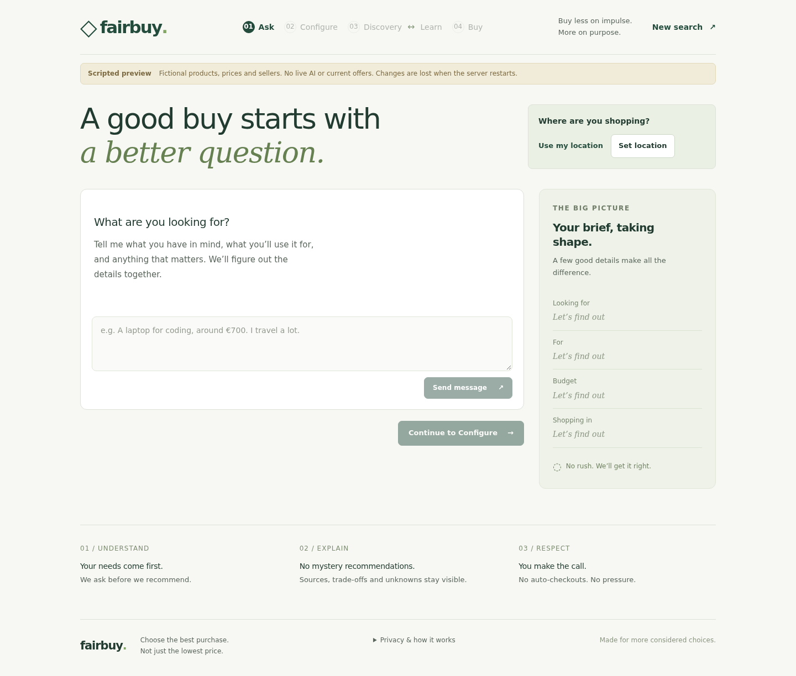
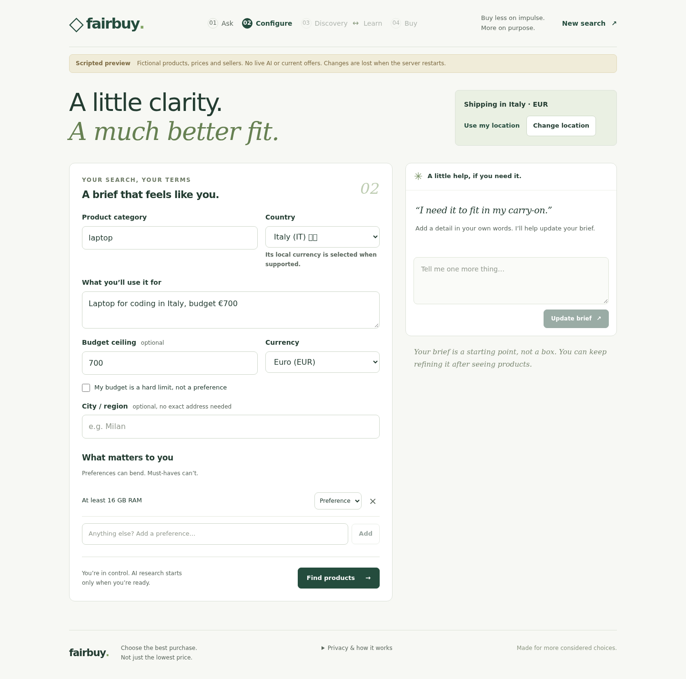
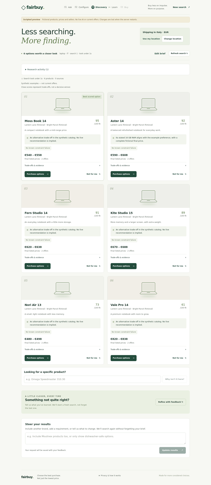
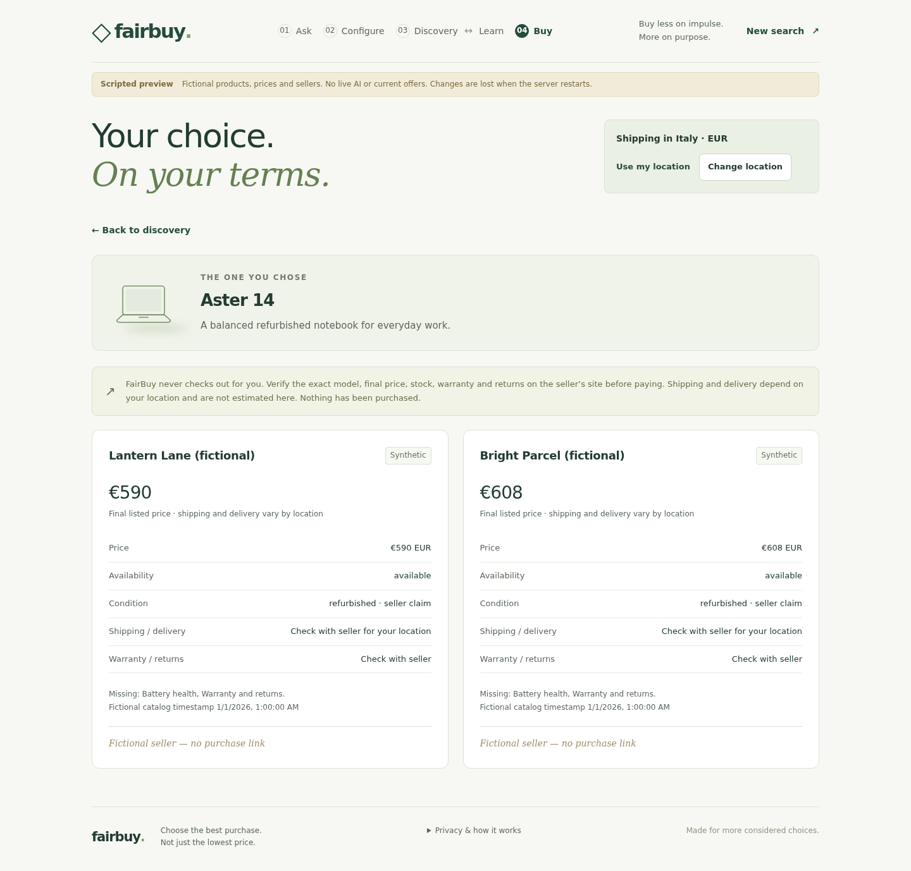

# FairBuy UI reference

Screenshots of the real frontend using a fictional demo shopping session.
These are static visual references, not interactive shopping pages.

Open `index.html` in a browser to switch between pages, or serve this folder:

```sh
python3 -m http.server 11101 --bind 0.0.0.0 --directory preview
```

Then visit <http://oc.home.arpa:11101> (or <http://localhost:11101> locally).
If port 11101 is already in use, stop the existing preview server or choose another port.

## Ask



## Configure



## Discover



## Buy


